<div align="center">

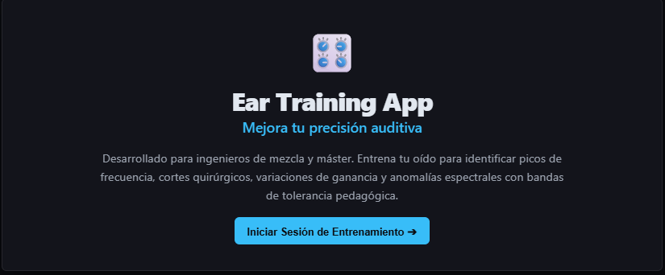

<h1>🎚️ Ear Training Pro</h1>

<p><b>Advanced audio-engineering simulator · parametric EQ & dynamic-range ear training</b></p>

<p><em>Train your ears on real multitrack stems, inside a hyper-realistic VST-style interface — no install, no build step, right in the browser.</em></p>

<p>
  <a href="https://manwell47.github.io/ear-training/"></a>
  <a href="https://github.com/manwell47/ear-training"></a>
  <a href="LICENSE"></a>
</p>

<p>
  
  
  
  
  
  
</p>

</div>

---

## 📖 Overview

**Ear Training Pro** is an open-source, browser-based training platform that turns ear training into real mixing practice. It blends a hyper-realistic VST-style UI with a rigorous Web Audio DSP chain, so every exercise is auditioned on **real multitrack stems** — not synthetic drills.

Instead of a binary right/wrong, a **Pedagogical Director** explains *why* a move matters (masking, topology, filter type, perceptual weighting), turning each attempt into a lesson.

> 🗣️ The application UI is in **Spanish (ES)** — this README is in English for the international GitHub community.

<div align="center">

| 🎼 24 acoustic classes | 🔊 32 audio sources | 🎮 3 game modes |
|:---:|:---:|:---:|
| **⚙️ 4 difficulty tiers** | **🎛️ 5 compressor models** | **✅ 129 automated checks** |

</div>

---

## ✨ Highlights

- **🎧 Multitrack Stem Mixer** — Load complete sessions (Beat 1, Rock Band, Symphony Orchestra) and ride individual faders with mute/solo and layered real-time VU meters that sit *behind* transparent faders to save screen space.
- **🎚️ Surgical EQ Simulator** — A parametric EQ with draggable nodes, inline Q/gain editing and a live transfer response, modelled after professional DAWs and VST plugins.
- **🎛️ Dynamic Range Lab** — A full compressor workbench: downward **and** upward compression, sidechain, five compressor families, Pro-C2-style UI and a high-resolution gain-reduction scope.
- **🎓 Pedagogical Director** — Continuous scoring with categorical gates (filter topology, compressor style, sidechain routing) plus plain-language feedback on every result.
- **📈 VST-fidelity visualisation** — High-performance Canvas RTA with dB-calibrated tilt and temporal ballistics (RMS/EMA) that mirror how engineers actually read an analyser.
- **🧠 A/B/X Comparison Engine** — Instantly toggle between the dry signal and your processing to sharpen comparative listening.
- **🏆 RPG progression** — Rank up from *Cable Puller* to *Senior Mixing Engineer*, unlock tighter tolerances and face Stage-5 "Boss Battles".

---

## 🖥️ A Tour of the App

### Choose your discipline, mode and material

| Module selection | Game mode |
|:---:|:---:|
| 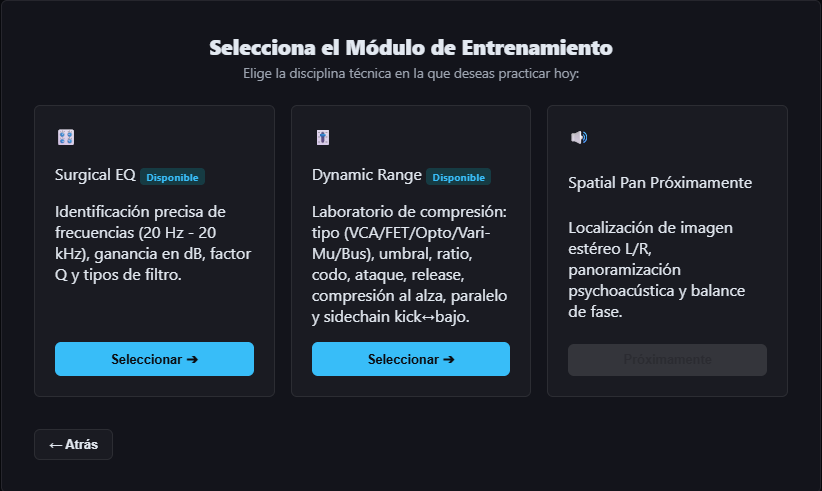 | 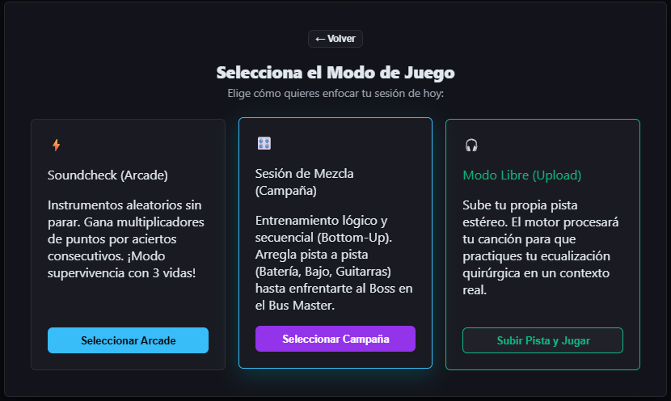 |
| *Surgical EQ or Dynamic Range* | *Arcade, Campaign or Free Mode* |

| Multitrack campaign | Difficulty ladder |
|:---:|:---:|
| 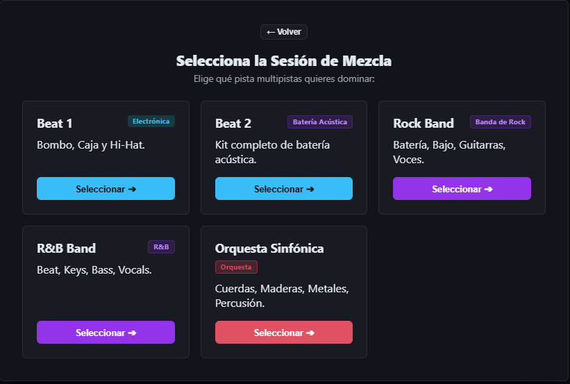 | 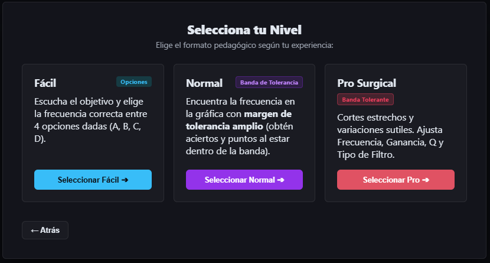 |
| *Progress from kick & bass to the master bus* | *From 4-option listening to surgical manual entry* |

---

## 🎛️ Dynamic Range Lab

A dedicated compression laboratory with four sub-modes — **Explore**, **Theory**, **Guided Practice** and **Case Studies** — built on a custom `AudioWorkletProcessor` (Web Audio alone cannot provide upward compression, external sidechain, program-dependent release or per-model character).

<div align="center">
  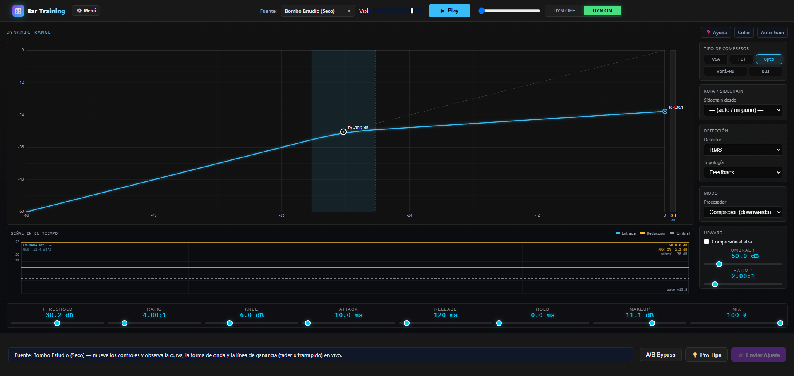
</div>

| Theory & interactive ADSR | Compression models |
|:---:|:---:|
| 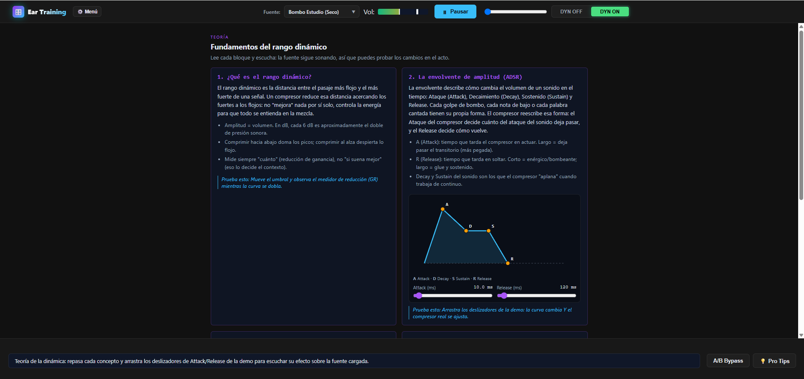 | 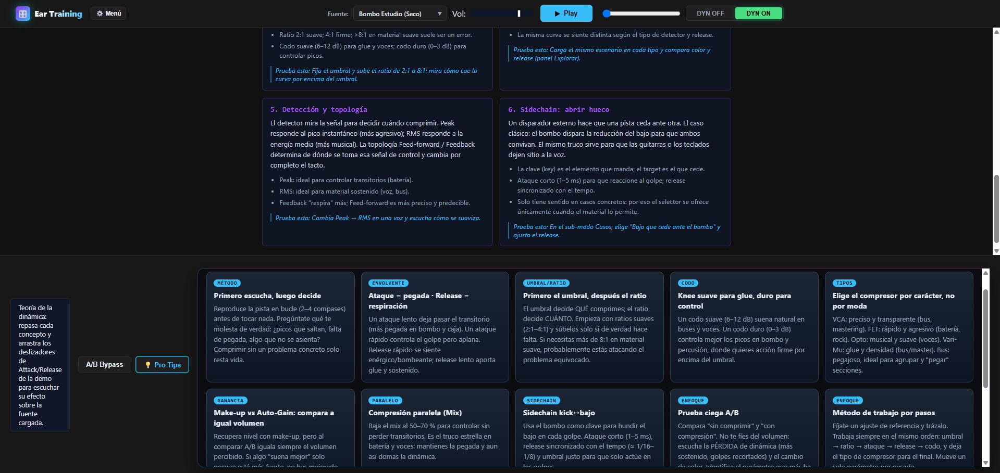 |
| *Interactive ADSR envelope — pure, verifiable geometry* | *VCA · FET · Opto · Vari-Mu · Bus character* |

| Lab launcher | Guided Practice |
|:---:|:---:|
| 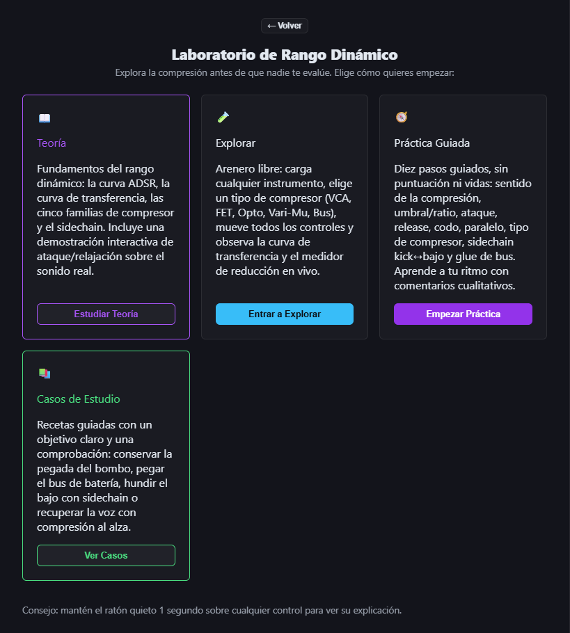 | 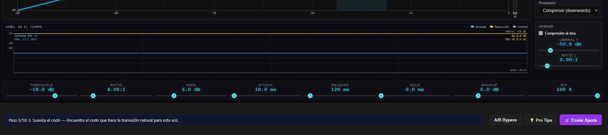 |
| *Explore · Theory · Practice · Cases* | *Qualitative ✓ / ≈ / ✗ checklist — no scores, no lives* |

**Inside the lab**

- **High-resolution GR ribbon** — the gain-reduction strip interpolates the \|GR\| across 2880 columns, so the amber band is a smooth edge instead of a staircase.
- **PRO readout** — integrated **RMS**, a **frozen peak** maximum and a **frozen max GR**, with digits refreshed at 6 Hz (stable numbers, fluid waveform).
- **Fully grabbable knobs** — every parameter slider is draggable in **all** sub-modes, and a 1-second press on any label opens contextual help (threshold, ratio, knee, attack/release/hold, makeup, mix, detector, feedback, sidechain, and the five **compressor families**).
- **10 guided case studies, 3 sidechain presets and 12 pro tips** ship as first-class content.

---

## 🎮 Game Modes

### 1. Arcade Mode *(randomised)*
Jump straight in. The engine serves a random stem and applies a secret EQ move — identify the **frequency**, estimate the **gain** and dial in the **Q**.

### 2. Mix Session Campaign *(bottom-up)*
Train progressively on complete multitrack songs:
- start with foundational elements (kick, bass),
- move through guitars, keys and synths,
- finish with vocals and the **master-bus Boss Battle**.

### 3. Free Mode *(bring your own music)*
Drop in any `.mp3` / `.wav` and the engine turns it into a pedagogical sandbox.

---

## 🎚️ Adaptive Difficulty

The simulation scales to your listening skill — start broad, end surgical:

| Fácil (Easy) | Normal |
|:---:|:---:|
| 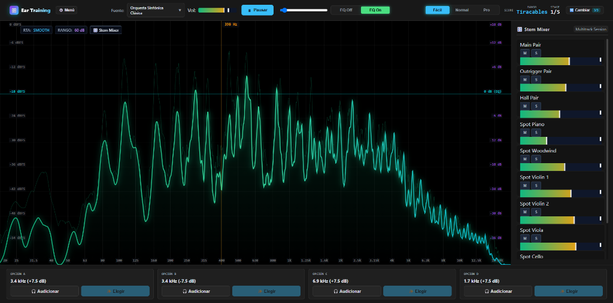 | 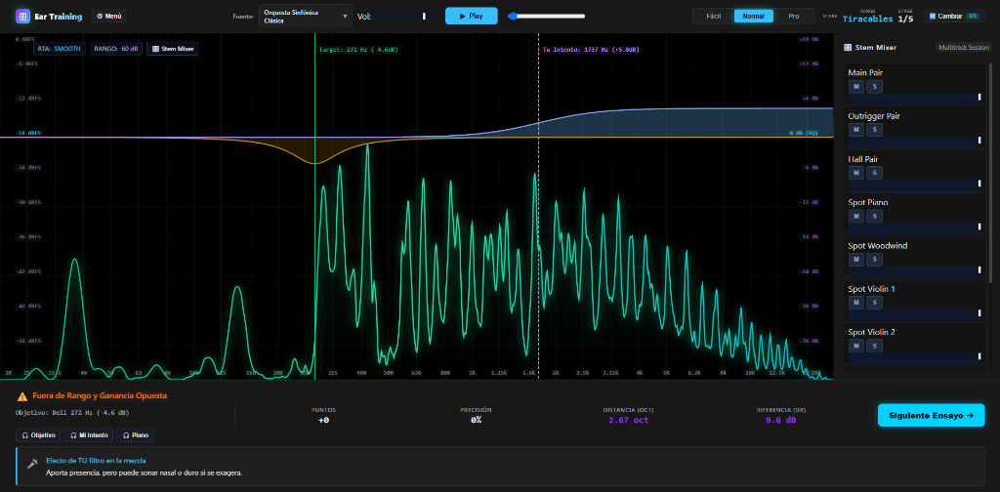 |
| Pick the altered frequency from four options (A/B/C/D). | Find it on the spectrum analyser with a visual tolerance band. |

| Pro Surgical | Progression |
|:---:|:---:|
| 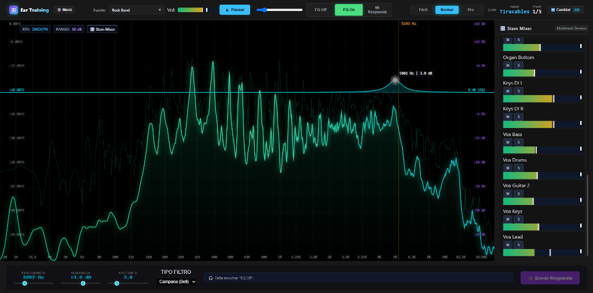 | 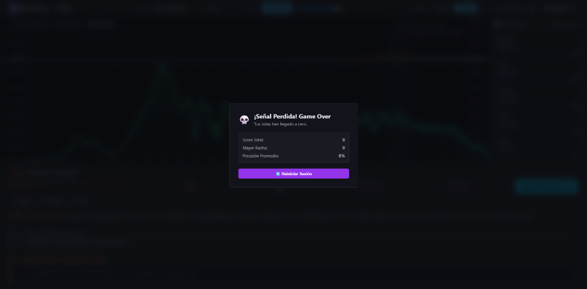 |
| Ultra-narrow cuts and subtle boosts; enter frequency, gain **and** filter type by hand. | Earn points and multipliers, rank up — run out of lives and it's game over. |

---

## 🛠️ Technical Architecture

Built entirely with **vanilla web technologies** — no frameworks, no bundlers, no `npm install`. Modules are native ES6 and served directly.

| Layer | Implementation |
|---|---|
| **UI** | Vanilla HTML5 + CSS3 (dark glassmorphism), Canvases for all graphs |
| **Audio / DSP** | Web Audio API — `BiquadFilterNode`, `AnalyserNode`, `GainNode`, plus a custom `AudioWorkletProcessor` for dynamics |
| **Visualisation** | HTML5 `<canvas>` with optimised `requestAnimationFrame` loops (RTA, transfer curve, GR scope, ADSR) |
| **Pedagogy** | `AcousticMatrix` (24 acoustic classes) and `DynamicsMatrix` (theories, help, scenarios, curriculum) as **single sources of truth** |
| **Verification** | `tools/verify_modules.mjs` — autonomous ESM sandbox running **129 checks** (syntax, invariants, DSP maths, content coverage, cache-buster) |
| **Deployment** | Static hosting on **GitHub Pages**, with a unified `?v=N` cache-busting suffix |

---

## 🚀 Getting Started

No dependencies to install — just serve the folder.

**Option A — bundled dev server** (recommended; sends `no-store` to defeat caching):

```bash
PORT=8090 node dev-server.js
# Windows (cmd):
set PORT=8090 && node dev-server.js
```

**Option B — any static server:**

```bash
git clone https://github.com/manwell47/ear-training.git
cd ear-training
python -m http.server 5500
```

Then open <http://localhost:8090> (or `http://localhost:5500`) and click **Play**.

> 💡 Chrome/Edge/Firefox recommended. Audio starts after the first user gesture (browser autoplay policy).

---

## 🧪 Verification

The repository ships a self-contained verifier that copies the modules into a temporary ESM sandbox, strips the `?v=N` suffixes and asserts both **structure** and **behaviour**:

```bash
node tools/verify_modules.mjs
# → ALL PASS (129 checks)
```

It covers syntax, acoustic-class coverage, alias resolution, DSP transfer-function maths, upward/downward mirroring, sanitisation clamps, scoring gates, ADSR geometry, scope/meter ballistics, the GR ribbon resolution, help-key coverage and the unified cache-buster invariant.

---

## 📁 Project Structure

```
ear-training/
├─ index.html              # Single-page app shell
├─ styles_v2.css           # Live stylesheet
├─ dev-server.js           # Zero-dependency static dev server
├─ assets/                 # Screenshots used by this README
├─ plans/                  # Design & implementation plans
├─ src/
│  ├─ web/                 # Live ES modules (App, AudioEngine, Visualizer, …)
│  │  ├─ App.js            # Main controller
│  │  ├─ AudioEngine.js    # Web Audio graph, routing A/B/C, multitrack
│  │  ├─ AcousticMatrix.js # EQ pedagogy (single source of truth)
│  │  ├─ DynamicsMatrix.js # Dynamics pedagogy (single source of truth)
│  │  ├─ DynamicsLab.js    # Explore / Theory / Practice / Case orchestration
│  │  ├─ CompressorUI.js   # Pro-C2 style transfer-curve renderer
│  │  ├─ DynamicsScopeRenderer.js # Time-domain scope + PRO readout
│  │  └─ …                 # Scoring, training, VU, tooltips, theory
│  └─ AudioEngine/         # C++ reference engine (not used by the web build)
├─ tools/verify_modules.mjs# 129-check autonomous verifier
├─ CHECKPOINT.md           # File map + known pitfalls
└─ PROJECT_STATE.md        # Architecture snapshot & milestones
```

---

## 🗺️ Roadmap

- [x] Core Web Audio routing and EQ processing
- [x] High-fidelity Canvas RTA visualiser
- [x] Scoring engine with RPG rank progression
- [x] Multitrack stem loading and mixing faders
- [x] Advanced dynamic-range compression training *(Dynamic Range Lab: upward/downward, 5 compressor models, sidechain, Pro-C2 style UI)*
- [ ] User accounts and cloud progress sync
- [ ] Mobile / tablet responsive layout pass

---

## 📚 Documentation

- **[`CHECKPOINT.md`](CHECKPOINT.md)** — file map with line anchors, verification procedure and known pitfalls.
- **[`PROJECT_STATE.md`](PROJECT_STATE.md)** — architecture snapshot and completed milestones.
- **[`plans/`](plans)** — the design plans behind the EQ module and the Dynamics Lab.

---

## 🤝 Contributing

Contributions are welcome — new audio stems, better pedagogical feedback strings, UI polish or bug fixes.

1. Fork the repository
2. Create your branch (`git checkout -b feature/AmazingFeature`)
3. Commit your changes (`git commit -m 'Add some AmazingFeature'`)
4. Push the branch (`git push origin feature/AmazingFeature`)
5. Open a Pull Request

Before opening a PR, please run `node tools/verify_modules.mjs` and keep it green ✅.

---

## 📄 License

Released under the [MIT License](LICENSE).

<div align="center">

**Made with ❤️ for audio engineers, producers and sound students.**

<a href="https://manwell47.github.io/ear-training/"><strong>🎧 Start training now →</strong></a>

</div>
