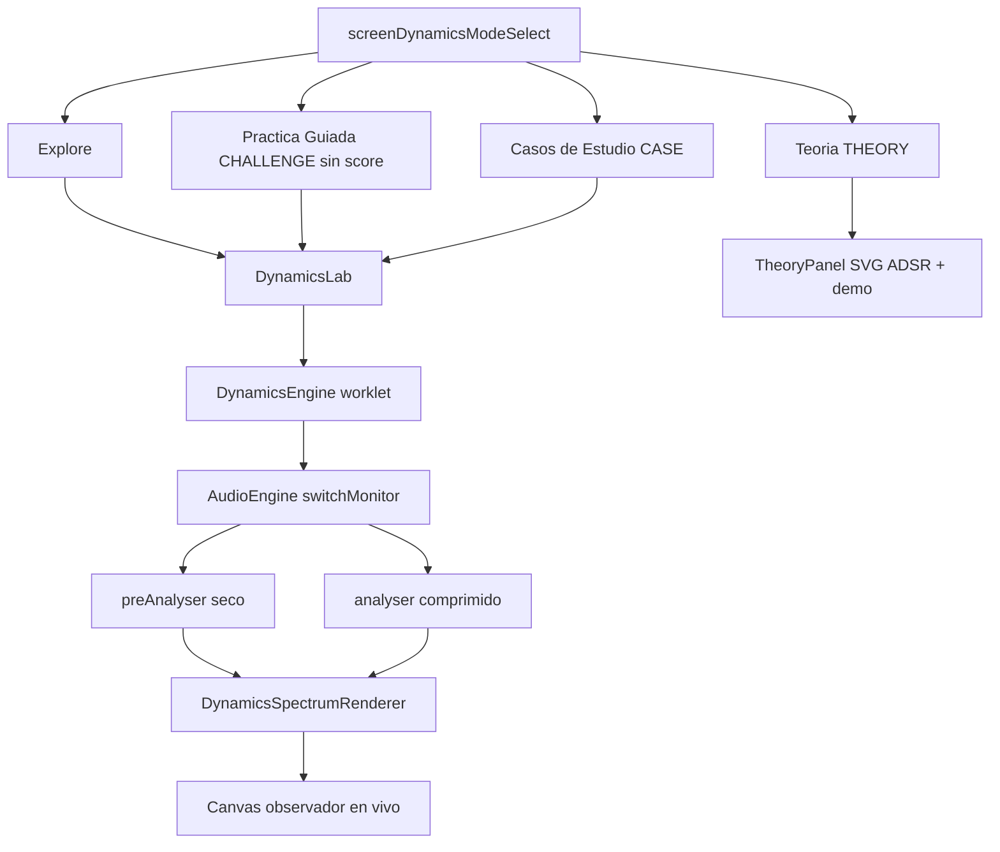
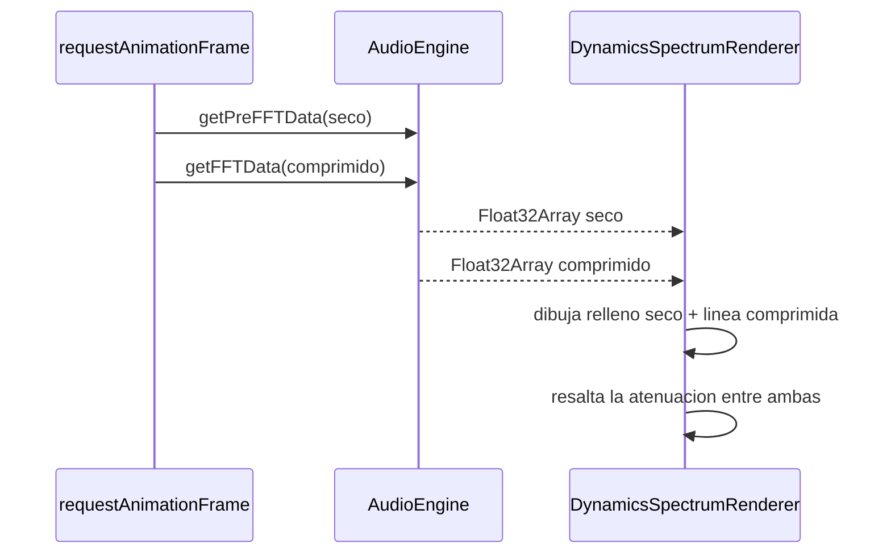

# DYNAMIC RANGE — Reorientación a Laboratorio Didáctico (WS-M)

> Documento de planificación para revisión previa a implementación.
> Modo autor: Architect. Rama de trabajo: `js-dev` / `main`.
> Estado de partida: módulo DYNAMIC RANGE ya construido y verificado (96 checks PASS), build cache-bust `src/web/*.js?v=73` + `index.html?v=74`.
> **ESTADO ACTUAL (WS-M): implementado.** E1–E6 entregados (E3 espectro retirado a favor del scope temporal; E5 Práctica Guiada sin score incluida). Añadido **E7** (readout PRO con *ballistics*, Casos de Estudio *pineados* y cabecera sin Fácil/Normal/Pro) y **M10** (cinta de GR de alta resolución: `SCOPE_COLUMNS`=2880, `SCOPE_COLS_PER_FRAME`=16, interpolación del |GR|). Resultado real y pendientes en §9. Verificación: `node tools/verify_modules.mjs` → **ALL PASS (129 checks)**; cache-bust unificado a **`?v=80`**.

---

## 1. Objetivo (CAMBIO DE RUMBO)

Reorientar el módulo **Dynamic Range** de un "juego de compresión con puntuación" a un **laboratorio didáctico de dinámicas**. Concretamente:

1. Reemplazar la etiqueta **"🏆 Consejos de Maestro"** por **"💡 Pro Tips"** (renombrar UI + textos).
2. Añadir un sub-modo **"Teoría"** con material conceptual e **ilustraciones de la curva ADSR** (SVG) más una **demo interactiva ataque/release**.
3. Mostrar la **envolvente del espectro siendo atenuado en tiempo real** (comparativa seco vs comprimido).
4. **Sidechain sólo en los casos didácticos adecuados** (Bajo→Bombo, Guitarras→Voz, Teclados→Voz), con presets que hoy no ofrece nada.
5. **Crear casos de uso y entrenamiento específico** (guiado, sin puntuación competitiva).
6. **Des-competitivizar el sub-modo "Desafíos"**: convertirlo en práctica guiada sin puntos/vidas (ocultar HUD de score).

> Principio rector: **enseñar el "por qué"** (envelope, detección, transferencia, sidechain) antes que "acertar un número".

---

## 2. Hechos técnicos confirmados (de la investigación)

| Hallazgo | Detalle | Implicación |
|---|---|---|
| `preAnalyser` ya existe | [`AudioEngine.js:105`](src/web/AudioEngine.js:105) (creado en `initNodes`), tap pre-insert en [`AudioEngine.js:830`](src/web/AudioEngine.js:830) | Permite FFT **seco (pre)** vs **húmedo (post)** sin tocar el DSP del worklet |
| `analyser` (post) | [`AudioEngine.js:99`](src/web/AudioEngine.js:99) | FFT comprimido (master) |
| API de FFT | [`getFFTData()`](src/web/AudioEngine.js:1089) y [`getPreFFTData()`](src/web/AudioEngine.js:1095) | Ya expuestas; listas para un renderer dedicado |
| Sidechain = mismo session | [`_wireDynamicsSidechain()`](src/web/AudioEngine.js:760) conecta `stemGainNodes[stemId]` al input 1 | Target y Key **deben ser stems de la misma `currentMultitrackSession`** |
| Sesiones válidas | `rock_band_session` (targetStem `rb_kick`; tiene `rb_bass_di`, `rb_gtr1/2`, `rb_keys_l/r`, `vox_lead_m80`) y `rb_session` (targetStem `rb_kick_in`; `rb_gtr_cu29/m80`, `rb_keys_org/wurli`, `rb_vox_lead`) | Sólo estos permiten los pares didácticos reales |
| Selector sidechain vacío | [`#dynSidechainSelect`](index.html:175) sólo tiene `<option value="">— (auto / ninguno) —</option>` y se rellena en [`_populateDynamicsSidechain()`](src/web/App.js:826) | Rehacer su poblado condicionado al caso |
| Escenarios con sidechain | `bass_duck_kick` en [`DynamicsMatrix.js`](src/web/DynamicsMatrix.js:331) con `sidechain:{sessionId:'rock_band_session', sourceStemId:'rb_kick'}` | Patrón ya existente a ampliar |
| No existe ADSR | búsqueda `adsr|envelope|spectrum` sin resultados de ilustración | Hay que crear SVG/teoría desde cero |
| Pro Tips fuente | [`DYNAMICS_MASTER_TIPS`](src/web/DynamicsMatrix.js:462) (12 items `{tag,title,body}`) | Renombrar UI y reutilizar contenido didáctico |
| Lecciones existentes | [`DYNAMICS_LESSONS`](src/web/DynamicsMatrix.js:525) (8 bloques con `concept`/`tryThis`) | Base para el sub-modo Teoría |
| Tipos/modos | `DYNAMICS_LAB_MODES = {EXPLORE, CHALLENGE, CASE}` en [`DynamicsLab.js:56`](src/web/DynamicsLab.js:56) | Hay que **añadir `THEORY`** |
| Bypass ya cableado | [`DynamicsLab.setBypass()`](src/web/DynamicsLab.js:414) + [`_reflectDynamicsBypass()`](src/web/App.js:1940) | Sirve para A/B manual en la demo de espectro |

---

## 3. Arquitectura objetivo

**Flujo de datos del espectro en vivo:**

---

## 4. Alcance por entregable

### E1 — Renombrar "Consejos de Maestro" → "Pro Tips"
- **UI:** botón [`#dynTipsBtn`](index.html) en `#dynamicsDockSection` (texto "🏆 Consejos de Maestro" → "💡 Pro Tips").
- **Contenido:** [`DYNAMICS_MASTER_TIPS`](src/web/DynamicsMatrix.js:462) — ajustar `tag`/`body` para tono "pro tip"; mantener 12 items (o reclasificar los 2 de "Competitivo" a "Enfoque").
- **Renderer:** [`_renderDynamicsTips()`](src/web/App.js:1951) — encabezado del panel a "Pro Tips".
- **Decisión pendiente:** ¿renombrar también el **símbolo exportado** `DYNAMICS_MASTER_TIPS`? (recomendado: mantener el nombre exportado para no romper imports; sólo cambiar textos visibles).

### E2 — Nuevo sub-modo "Teoría" (THEORY)
- **Modelo:** añadir `THEORY` a [`DYNAMICS_LAB_MODES`](src/web/DynamicsLab.js:56) (congelado).
- **Contenido teórico:** nuevo bloque `DYNAMICS_THEORY` en [`DynamicsMatrix.js`](src/web/DynamicsMatrix.js) con secciones:
  1. ¿Qué es la dinámica y el rango dinámico?
  2. La envolvente de amplitud: **ADSR** (Ataque, Decaimiento, Sostenido, Release).
  3. Umbral, Ratio, Codo, Makeup, Mix.
  4. Tipos de compresor (VCA/FET/Opto/Vari-Mu/Bus) — reutiliza [`COMPRESSOR_TYPES`](src/web/DynamicsMatrix.js:32).
  5. Detección: Feed-forward vs Feedback, Detector Peak/RMS, Stereo Link.
  6. Sidechain: el "ducking" musical.
- **Ilustración ADSR (SVG):** componente que dibuja la curva A→D→S→R con etiquetas y una nota "cómo lo modula cada parámetro del compresor" (Attack ↔ tiempos de A; Release ↔ tiempos de R).
- **Demo interactiva ataque/release:** sliders que (a) mueven los tramos A y R en el gráfico SVG y (b) **se reflejan en los knobs Attack/Release reales** del `DynamicsLab` (para el caso activo), con audio de un stem para escuchar el efecto.
- **Montaje/desmontaje:** nueva función `startDynamicsTheory()` en [`App.js`](src/web/App.js) que oculta el juego, monta el panel de teoría, y `exitDynamicsLab()` debe limpiarlo.

### E3 — Envolvente del espectro atenuado en tiempo real
- **Nuevo renderer:** `src/web/DynamicsSpectrumRenderer.js` (canvas dedicado, p. ej. dentro del `#dynamicsPanel` o bajo la UI del compresor):
  - Fondo: FFT **seco** (`getPreFFTData`) como área/relleno tenue.
  - Línea: FFT **comprimido** (`getFFTData`) encima.
  - **Highlight** de la atenuación (diferencia seco−comprimido) por banda, con lectura opcional "GR por banda".
- **Lógica de dibujo:** reutilizar la calibración/tilt RTA de [`drawSpectrum()`](src/web/Visualizer_v2.js:568) (unos +4.5 dB/oct, offsets de calibración, ballistics), pero en un canvas propio y simplificado (sin interacción de nodos EQ).
- **Ciclo de vida:** arrancar/parar con `requestAnimationFrame` al entrar/salir del laboratorio; no consumir CPU cuando está oculto.
- **Guard frente a no-disponibilidad:** si `getPreFFTData` no existe (defensivo), degradar a un único trazo.

### E4 — Sidechain sólo en casos didácticos adecuados
- **Nuevo catálogo `DYNAMICS_SIDECHAIN_CASES`** (en [`DynamicsMatrix.js`](src/web/DynamicsMatrix.js)) con presets **explicitados como session+targetStem+keyStem**:
  1. **Bajo → Bombo** — sesión `rock_band_session`; target `rb_bass_di`; key `rb_kick`. (ya existe `bass_duck_kick`; ampliar a preset de UI)
  2. **Guitarras → Voz** — `rock_band_session`; target `rb_gtr1`/`rb_gtr2`; key `vox_lead_m80`.
  3. **Teclados → Voz** — `rock_band_session`; target `rb_keys_l`/`rb_keys_r`; key `vox_lead_m80`.
  - (Alternativa con `rb_session`: `rb_gtr_cu29/m80` o `rb_keys_org/wurli` keyed por `rb_vox_lead`.)
- **Comportamiento del selector [`#dynSidechainSelect`](index.html:175):**
  - **Oculto/deshabilitado** cuando el caso activo NO admite sidechain.
  - **Visible y poblado** sólo cuando el caso didáctico lo declara, mostrando el preset con etiqueta legible (p. ej. "Bajo ← Bombo (rock_band_session)").
- **Cableado:** reutilizar [`_populateDynamicsSidechain()`](src/web/App.js:826) + [`_loadSidechainSession()`](src/web/App.js:442) + [`DynamicsLab.loadScenarioSidechain()`](src/web/DynamicsLab.js:463) + [`AudioEngine._wireDynamicsSidechain()`](src/web/AudioEngine.js:760).
- **Regla dura:** si target y key no pertenecen a la `currentMultitrackSession`, la opción no se ofrece (evita el fallo actual de "no ofrece nada").

### E5 — Des-compatitivizar "Desafíos" → Práctica Guiada
- **HUD:** ocultar score/vidas durante el sub-modo (comprobar `renderHUD()` / [`renderLives()`](src/web/App.js:2017) y el `#resultsDockSection`).
- **Modelo:** renombrar etiqueta de UI "Desafíos" → "Práctica Guiada"; `startChallenge()` sigue existiendo pero sin puntuar (o con feedback puramente cualitativo vía [`ScoringEngine.evaluateDynamics()`](src/web/ScoringEngine.js:343) sin mostrar número).
- **Tarjeta de modo:** editar [`#screenDynamicsModeSelect`](index.html:576) (card `data-dyn-mode="challenge"`).
- **Feedback:** sustituir "puntos" por checklist de logros ("Acercaste el umbral", "Ratio en rango", "Attack adecuado para transiente").

### E6 — Casos de uso y entrenamiento específico
- **Ampliar `DYNAMICS_CASE_STUDIES`** ([`DynamicsLab.js:107`](src/web/DynamicsLab.js:107)) con casos guiados nuevos por objetivo, p. ej.:
  - "Controla el transiente del bombo" (attack lento vs rápido).
  - "Pega el drum-bus" (buss compressing, ratio suave, codo).
  - "Abre hueco con sidechain" (Bajo→Bombo).
  - "Haz que la voz mande" (Guitarras/Teclados→Voz).
  - "Pegado de máster con glue suave".
- Cada caso: `goal`, `tips` (pro tips), `checks` cualitativos y **botón "escuchar antes/después"** usando bypass ([`setBypass()`](src/web/DynamicsLab.js:414)).

---

## 5. Cambios por archivo (mapa de impacto)

| Archivo | Cambio |
|---|---|
| [`index.html`](index.html) | Textos Pro Tips; card Teoría en `#screenDynamicsModeSelect`; posible contenedor canvas de espectro; grupo de la demo ADSR; relabel de tarjeta Desafíos |
| [`src/web/DynamicsMatrix.js`](src/web/DynamicsMatrix.js) | Nuevos `DYNAMICS_THEORY`, `DYNAMICS_SIDECHAIN_CASES`; textos Pro Tips; casos nuevos |
| [`src/web/DynamicsLab.js`](src/web/DynamicsLab.js) | `THEORY` en modos; carga de casos sidechain; API de demo ataque/release (set params) |
| [`src/web/App.js`](src/web/App.js) | `startDynamicsTheory()`; montaje/teardown del renderer de espectro y del panel de teoría; `_populateDynamicsSidechain()` condicional; ocultar HUD en práctica guiada |
| [`src/web/DynamicsSpectrumRenderer.js`](src/web/DynamicsSpectrumRenderer.js) | **NUEVO** — renderer seco vs comprimido en canvas |
| [`src/web/TheoryPanel.js`](src/web/TheoryPanel.js) | **NUEVO** (o helpers en App) — SVG ADSR + demo interactiva |
| [`styles_v2.css`](styles_v2.css) | Estilos del panel Teoría, ADSR, canvas de espectro, estados deshabilitado del selector sidechain |
| `tools/verify_modules.mjs` | Extendido a los nuevos módulos/exports (**129 checks ALL PASS**: helpers puros del scope + medidor PRO, ADSR, casos, sidechain, `DYNAMICS_THEORY`, `describePracticeAchievements` de la Práctica Guiada y la **cinta GR de alta resolución**) |

---

## 6. Decisiones abiertas (para confirmar en revisión)

1. **Ubicación del espectro en vivo:** ¿columna lateral del `#dynamicsPanel`, ¿dentro del dock, o bajo la curva del compresor? *(propuesta: bajo la UI del compresor, ancho completo).*
2. **Nombre exportado** `DYNAMICS_MASTER_TIPS`: ¿mantenerlo (recomendado) y sólo cambiar textos visibles, o renombrar a `DYNAMICS_PRO_TIPS` y actualizar imports?
3. **Teoría y audio:** ¿la demo A/R suena sobre el stem activo del caso, o sobre un loop fijo didáctico (p. ej. `v_kick`)?
4. **Práctica Guiada:** ¿feedback totalmente cualitativo (sin números) o mostrar "aciertos" pero nunca puntos/vidas?
5. **Alcance de presets sidechain:** ¿sólo los 3 pares de `rock_band_session`, o también variantes de `rb_session`?
6. **Persistencia:** ¿recordar el último sub-modo y último caso visitado (localStorage)?

---

## 7. Criterios de aceptación

- [x] "Pro Tips" aparece en botón y panel; no queda el texto "Consejos de Maestro" en UI.
- [x] Sub-modo **Teoría** accesible desde el selector; muestra ≥6 secciones y una **curva ADSR** legible con etiquetas A/D/S/R.
- [ ] La demo A/R mueve la ilustración **y** los knobs Attack/Release reales, con audio audible. — ⚠️ pendiente de confirmar el vínculo con los knobs reales del `DynamicsLab`.
- [x] ~~El canvas de espectro muestra en vivo **seco (relleno)** vs **comprimido (línea)**~~ ❌ **Descartado**: el pivote al **scope temporal** (dominio del tiempo) sustituye la envolvente espectral; el módulo se movió a `legacy/DynamicsSpectrumRenderer.js` y su verificación del espectro se eliminó.
- [x] El selector de **sidechain está oculto** cuando el caso no lo admite y **ofrece** exactamente los presets didácticos (Bajo→Bombo, Guitarras→Voz, Teclados→Voz) cuando sí.
- [x] "Práctica Guiada" **no muestra puntuación ni vidas**; ofrece feedback **cualitativo** (sin `(NN%)`) y checklist de logros (`✓`/`≈`/`✗`). — ✅ **entregado (E5)**.
- [x] Existen ≥2 casos de uso nuevos con objetivo + pro tips + checks (10 `DYNAMICS_CASE_STUDIES`).
- [x] `tools/verify_modules.mjs` pasa (**129 checks ALL PASS**) y el `?v` queda unificado a **`?v=80`** (`src/web/*.js` + `index.html`).
- [x] El readout numérico de dB del scope usa **RMS integrado** (`SCOPE_RMS_SECONDS`) + **máximo congelado** (`maxPeakDb`, sin decaimiento) y **refresca los dígitos** solo a `SCOPE_TEXT_HZ`; muestra `ENTRADA RMS` y, debajo, `MÁX` congelado, más `GR` a 1 decimal (fin del parpadeo por-frame). — ✅ **entregado (E7)**.
- [x] Los **Casos de Estudio** desactivan los controles no relevantes (`checks`) y **fijan la Fuente** de la cabecera; el selector **Fácil/Normal/Pro** se oculta en modo Dynamics. — ✅ **entregado (E7)**.
- [ ] Sin regresiones al salir a EQ (`exitDynamicsLab` limpia Teoría + espectro).

---

## 8. Orden de implementación sugerido

1. E1 (rename Pro Tips) — bajo riesgo, valida textos.
2. E2 (Teoría + ADSR + demo A/R) — valor didáctico principal.
3. E3 (espectro en vivo) — usa `preAnalyser`/`analyser` ya existentes.
4. E4 (sidechain condicional + presets).
5. E5 (práctica guiada sin score).
6. E6 (casos de uso y entreno).
7. Verificación (extender `verify_modules.mjs`) + bump `?v` + prueba local en `localhost:8080`.

> No se incluyen estimaciones de tiempo por política del proyecto.

---

## 9. Resultado real (WS-M)

Ejecutado sobre la app web viva. Verificación: `node tools/verify_modules.mjs` → **ALL PASS (129 checks)**; cache-bust unificado a **`?v=80`**.

**Entregado**
- **E1 — Pro Tips**: botón `#dynTipsBtn` y panel `#dynTipsPanel`; [`DYNAMICS_MASTER_TIPS`](src/web/DynamicsMatrix.js:513) (12 tips) renderizados por [`App._renderDynamicsTips()`](src/web/App.js:2283).
- **E2 — Teoría + ADSR**: [`DYNAMICS_THEORY`](src/web/DynamicsMatrix.js:651) (6 bloques) + [`TheoryPanel.js`](src/web/TheoryPanel.js:109) con envolvente ADSR interactiva y geometría pura verificable (`ADSR_DEFAULTS`/`adsrVertices()`/`buildAdsrPath()`). Panel `#theoryPanel`.
- **E3 — Espectro** *(retirado)*: [`DynamicsSpectrumRenderer.js`](src/web/DynamicsSpectrumRenderer.js) se creó y verificó (ejes/remuestreo puros), pero el pivote a la **gráfica temporal** ([`DynamicsScopeRenderer.js`](src/web/DynamicsScopeRenderer.js:171), en `#dynScopeCanvas`, complementaria a la curva; osciloscopio de barrido min/max del waveform de entrada con auto-normalización + cinta de GR) lo dejó sin uso. Se **movió a `legacy/DynamicsSpectrumRenderer.js`** y su sección de verificación del espectro se eliminó (127 → 112 checks); con E5 (2 checks), los 2 invariantes de cache-buster y los **12 checks del medidor PRO del scope** (`DynamicsScopeRenderer`) el total real es **129 checks** (incluye el nuevo check de la **cinta GR de alta resolución**).
- **E4 — Sidechain**: [`DYNAMICS_SIDECHAIN_CASES`](src/web/DynamicsMatrix.js:475) (3 presets reales de `rock_band_session`) + `describeSidechainCases()`; bloque `#dynSidechainBlock`/`#dynSidechainSelect`.
- **E6 — Casos**: [`DYNAMICS_CASE_STUDIES`](src/web/DynamicsLab.js:111) (10 casos) con `checkCase`/`revealCaseTarget` y veredicto `#dynCaseVerdict`.

- **E5 — Práctica Guiada sin score**: tarjeta "Desafíos"→"Práctica Guiada"; [`App._setGameHudVisible(false)`](src/web/App.js:664) oculta score/vidas/swap durante el sub-modo; feedback **sin números** (regex que elimina el `(NN%)` de `feedbackMessage`) + checklist cualitativa `✓`/`≈`/`✗` vía [`describePracticeAchievements()`](src/web/DynamicsLab.js:352) emitida en el `RESULT` de [`submitChallenge()`](src/web/DynamicsLab.js:692) y renderizada por [`App._renderPracticeChecklist()`](src/web/App.js:1072) en `#dynCaseVerdict`. Verificado por 2 invariantes (puro + mapeo `ok`/`close`/`miss` sin dígitos).
- **E7 — Readout PRO · Casos *pineados* · cabecera**: (a) [`DynamicsScopeRenderer._updateMeter()`](src/web/DynamicsScopeRenderer.js:470) **integra el RMS** (`SCOPE_RMS_SECONDS`) + **congela el máximo** (`maxPeakDb`, sin decaimiento) y limita el refresco de dígitos a `SCOPE_TEXT_HZ`, de modo que `_drawReadout()` muestra `ENTRADA RMS` y, debajo, `MÁX` estables (fin del parpadeo por-frame); (b) [`App._dynCaseUnlockedKeys()`](src/web/App.js:962) deriva el set editable de los `checks` del caso, `_applyDynamicsUnlockState()` desactiva lo no relevante, y `_lockDynamicsSource(true)` **fija la Fuente** (`.custom-select-wrapper.source-locked` + `#sourceSelect.disabled`) con la pista asignada nombrada en el prompt; (c) `#difficultyGroup` (Fácil/Normal/Pro) se oculta en `startDynamicsMode()` y se restaura en `exitDynamicsLab()`.

**Pendiente**
- **E2 — demo A/R → knobs reales**: confirmar el vínculo con Attack/Release del `DynamicsLab`.
- Regresión manual contra [`plans/REPAIR_PLAN.md`](plans/REPAIR_PLAN.md).
