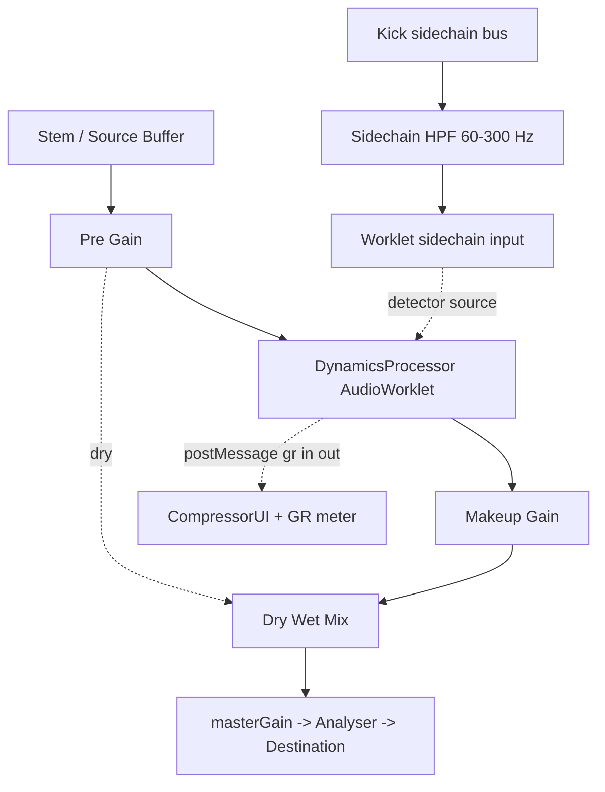

# Ear Training — DYNAMIC RANGE Module Plan (Specification for Code Mode)

Status: DRAFT — awaiting user approval
Author: Architect mode
Target: live web app (`src/web/`), GitHub Pages, no build step
Shape confirmed by user: **exploration Lab with optional scored challenges (hybrid)** + **custom AudioWorklet DSP** + **FabFilter Pro-C2 style Canvas UI**.

---

## 1. Purpose and guiding principle

Add the long-promised **Dynamic Range** module (currently a locked card at [`index.html:326`](index.html:326)) so a student can *explore* dynamics before being *tested* on them.

Priority order for every workstream:

1. **Honesty first.** The project rule §1 forbids "atajos psicoacústicos ni simplificaciones DSP". Web Audio's native `DynamicsCompressorNode` cannot do upward compression, has no sidechain input, no program-dependent release, no type character and no lookahead — so **we do not use it**. We ship a real `AudioWorklet` dynamics engine.
2. **Explore before you judge.** The Lab opens in *Explore* (free sandbox). *Challenge* (scored) is opt-in from the same UI.
3. **Never regress Surgical EQ.** Both modules coexist; switching must fully tear down the other's graph.

---

## 2. Competitive / pedagogical landscape (analysis)

| Product | What it does well | What it lacks for us | Take-away for the Lab |
|---|---|---|---|
| **SoundGym** (ear gym) | Gamified daily drills, XP/streaks, "compression" and "mix" games, huge progression | Mostly A/B multiple-choice, opaque scoring, no real parameter manipulation, no DSP transparency | Keep the streak/XP feel but make it *dial-in* not *guess-the-button* |
| **EarGym** (EarGym.com) | Structured exercises, compression detection, envelope/attack-recovery drills | Detection only, no sidechain, no compressor types, no transfer-curve view | Adopt attack/release *detection* drills as Challenge tier 1 |
| **Quiztones** | Fast EQ/compression/de-esser identification, clean UI | Commercial black box, no pedagogical "why", no sandbox | Keep fast feedback; add the "why" via Tooltips + pedagogical card |
| **Harman How to Listen** | Rigorous, honest, frequency-band training, no fluff | EQ only, no dynamics, desktop app | Adopt its *rigor* and its honesty about what is being tested |
| **TrainYourEars** | EQ + compression, adjustable tolerance, "which is more compressed?" | Limited dynamics depth, no visual transfer curve | Adopt adjustable tolerance; add the transfer curve |
| **FabFilter Pro-C2** | The reference UX: drag-the-curve transfer display, live GR meter, Expert panel, sidechain, external/realtime curves, program-dependent "style" (Clean/Classic/Opto/Vocal/Mastering/Bus/Punch) | It is *not* a teacher: no explanation of what a control does, no guided curriculum | Clone the *interaction* (curve-drag, GR meter, Expert panel) and bolt a **teaching layer** on top: hover-hold Tooltips, guided cases, pedagogical review |
| **iZotope / Sonnox docs** | Excellent prose on upward/downward, parallel, sidechain | Docs, not practice | Distil into the `DynamicsMatrix` didactic text |

**Positioning:** no commercial ear-trainer combines a *real* transparent compressor, the Pro-C2 drag-curve interaction, and an explicit teaching layer. That gap is exactly our Lab.

---

## 3. The didactic Lab — concept ("Dynamics Lab")

Three sub-modes behind one panel:

| Sub-mode | Purpose | Scoring |
|---|---|---|
| **🧪 Explorar (Explore)** | Free sandbox. Load any stem, load a *type* (VCA/FET/Opto/Vari-Mu/Bus), move every control, see the transfer curve and the live GR meter, A/B bypass, hear sidechain in real time. Tooltips teach each control. | none |
| **🎯 Desafíos (Challenge)** | Optional scored drills drawn from a fixed curriculum (below). | lives/points via `ScoringEngine` |
| **📚 Casos (Case Studies)** | Guided recipes with a goal sentence and a check: e.g. *"Glue the drum bus without killing the transients"*, *"Duck the bass under the kick with sidechain"*, *"Recover the quiet vocal with upward compression"*. | light, self-check |

### Challenge curriculum (progression)

1. **Sentido de la compresión** — is the signal compressed *down* or *up*? (upward vs downward)
2. **Umbral y ratio** — same ratio, different threshold: which is more compressed?
3. **Ataque** — does the compressor *eat* the transient or *let it through*?
4. **Release** — pumping vs pumping-free; tap the release.
5. **Knee** — hard vs soft; hear the transition.
6. **Makeup / Mix (paralelo)** — restore level honestly; hear parallel crush.
7. **Tipo de compresor** — identify VCA / FET / Opto / Vari-Mu / Bus from character alone.
8. **Sidechain kick↔bass** — duck the bass under the kick; then over-do it and hear the pumping.
9. **Bus glue** — 2:1, slow attack, auto-release on the drum bus.
10. **Boss: "El cliente"** — a mojibake mix needing several *correct* moves (de-mud, glue, sidechain) checked together.

### Curriculum ↔ available material

All targets come from existing assets only (rule §2: never invent tracks). [`AudioResourceManager.js:15`](src/web/AudioResourceManager.js:15) `MULTITRACK_SESSIONS` already gives us:

- **Kick/bass sidechain source of truth:** `rock_band_session` (has `rb_kick` + `rb_bass_di`) and `rb_session`.
- **Drum-bus glue source:** `rb_session` drums (kick in/out, snare top/bot, toms, OH, room).
- **Vocal dynamics / upward:** `vox_valve`, `vox_dyn`, `rb_vox_lead`.
- **Instrument-group EQ in a mix:** reuse the multitrack stems for bus shaping cases.

---

## 4. Technical architecture

### 4.1 Signal chain (new `D` lab branch)

### 4.2 AudioWorklet DSP — `src/web/dynamics-processor.js`

`registerProcessor('dynamics-processor', ...)`. Real DSP, parameterised by `AudioParam`/`port` messages:

- **Topology:** feed-forward detector (classic VCA/FET), with optional **feedback** mode (Vari-Mu/Opto emulation flavour).
- **Detector:** selectable **Peak** or **RMS** (fixed window); optional **true-peak 4× oversampled** detector for the mastering case.
- **Static curve:** `threshold`, `ratio`, `knee` (quadratic soft-knee). **Upward** stage: a second below-threshold anchor (`upwardThreshold`, `upwardRatio`) → gain *added* to quiet material. Both stages combine into one transfer function so the curve is continuous and drawable.
- **Ballistics:** `attack`, `release` as exponential time constants; `hold`; **program-dependent release** for Opto/Vari-Mu (dual time-constant release, fast+slow mix), like LA-2A / Fairchild behaviour.
- **Makeup:** manual `makeupGain` + optional **auto-gain** (matches RMS in→out).
- **Mix:** dry/wet (parallel compression).
- **Lookahead:** ⏸️ **deferred to a later "Mastering" tier** (user decision 2026-10-12); v1 ships **no lookahead and no delay-compensation**, so zero added latency.
- **Type character (`style`):** applies an honest, documented colouration model, **gated behind a separate `Color` on/off switch**. With `Color` **off** the engine is clean and only ballistics + curve differ per type (study the neutral transfer curve first); with `Color` **on** the type's harmonic/tube colouring is engaged. Model:
  - `vca` — clean, fast, transparent.
  - `fet` — ultra-fast attack, program-dependent release, mild 2nd/3rd-harmonic soft-clip on the control path (1176 flavour).
  - `opto` — slow, program-dependent dual release, gentle soft knee, slight 2nd harmonic (LA-2A flavour).
  - `varimu` — soft knee, asymmetric soft-clip (tube), smooth (Fairchild/Manley flavour).
  - `bus` — slow attack (~30 ms), low ratio (2:1/4:1), auto-release (SSL-glue flavour).
  Each style is a **damped preset** over the same engine, not a fake.
- **Stereo linking:** max/average link for L/R gain.
- **Telemetry:** throttled `port.postMessage({ grDb, inDb, outDb })` (~48 Hz) — **not** SharedArrayBuffer (GitHub Pages sends no COOP/COEP, so SAB is unavailable). The processor must never block the audio thread.

### 4.3 Main-thread engine — `src/web/DynamicsEngine.js`

- Creates the `AudioWorkletNode`, wires the **sidechain** input, exposes typed setters (`setStyle`, `setColor`, `setThreshold`, `setRatio`, `setKnee`, `setAttack`, `setRelease`, `setHold`, `setMakeup`, `setAutoGain`, `setMix`, `setDetector`, `setUpward`).
- Owns the **bypass A/B** (dry path vs processed) and reports `grDb` to subscribers (UI).
- Handles `addModule()` failure gracefully (console error, no silent noise fallback — rule §3).

### 4.4 Integration into `AudioEngine`

- New branch, **not** a mutation of the EQ graph: `buildDynamicsGraph(config)` / `setDynamicsConfig(params)` / `teardownDynamics()`, mirroring the deterministic pattern of [`buildGraph()`](src/web/AudioEngine.js:228) and [`switchMonitor()`](src/web/AudioEngine.js:658).
- Call `teardownDynamics()` (and `teardownGraph()`) when the module changes, to honour rule §3 (no parallel routing / leaks).
- Extend routing so the Lab can run: source → dynamics → master, with a **sidechain tap** taken from the multitrack `stemGainNode` of the kick (reuse [`updateStemVolumes()`](src/web/AudioEngine.js:602) plumbing rather than new buses).

### 4.5 Compressor UI — `src/web/CompressorUI.js` (Pro-C2 clone)

Canvas-based, matching the existing dark/glass theme ([`styles_v2.css`](styles_v2.css)):

- **Central transfer-curve display:** X = input dB (0 → −60), Y = output dB. Static curve drawn live from the DSP parameters, knee shaded, draggable **threshold/ratio** handles, real-time **operating dot**.
- **GR meter:** horizontal bar + short history trace, fed by worklet telemetry.
- **Expert panel:** Detector (Peak/RMS), sidechain HPF, feedback/feed-forward, stereo link, and the **`Color` on/off switch** (lookahead deferred).
- **Control row:** Threshold, Ratio, Knee, Attack, Release, Hold, Makeup, Mix knobs + **Color** toggle (pointer/keyboard, fine mode with Shift).
- **Type selector** chips: VCA / FET / Opto / Vari-Mu / Bus with a one-line character note.
- Mounted in a new workspace overlay `#dynamicsPanel` (workspace is [`index.html:112`](index.html:112)), shown instead of the EQ panel while the Lab is active.

### 4.6 Help system — hover-and-hold 1 s Tooltips

Requirement: *"al pasar el ratón y mantener en una posición un segundo popee una explicación rápida"*.

- New `src/web/TooltipController.js`: on `pointerenter` start a **1000 ms** timer; if the pointer stays inside → show a floating card (title + short text + "saber más" link to the pedagogical card); cancel on `pointerleave`/`pointerdown`/scroll.
- Attach via `data-help="key"` on DOM controls **and** via hit-test regions on the Canvas (knob/curve/handle hotspots), so canvas-drawn controls get tooltips too.
- Content dictionary `DynamicsHelp` (merged into `DynamicsMatrix`, see §4.7): one entry per control — *what it does* and *one practical tip*.
- Also expose an always-available **"?" overlay toggle** that pins all tooltips at once (teaching mode).

### 4.7 Pedagogical content — `src/web/DynamicsMatrix.js`

Mirrors the role of [`AcousticMatrix.js:7`](src/web/AcousticMatrix.js:7) but for dynamics. Single source of truth for:

- `COMPRESSOR_TYPES` — VCA/FET/Opto/Vari-Mu/Bus: character, when to use, famous units, and a `stylePreset` for the DSP.
- `DYNAMICS_SCENARIOS` — per instrument bus (drums, drum-bus, bass, vocal, guitar-bus, keys, master, orchestra): idiomatic moves (threshold/ratio/attack/release/knee/mix ranges + sidechain flags) + rationale text.
- `DYNAMICS_HELP` — tooltip strings per control.
- `DYNAMICS_LESSONS` — short didactic blocks surfaced in the review card, analogous to the EQ "Lección Rápida".

---

## 5. App integration

- **Activate module card:** [`index.html:326`](index.html:326) — unlock the Dynamic Range card, give the button `id="btnSelectDynamicRange"`, change badge from `Próximamente` to `Disponible`.
- **New app state:** add `DYNAMICS_MODE_SELECT` and `DYNAMICS_LAB` to [`setAppState()`](src/web/App.js:128); add a small sub-mode chooser screen (Explore / Challenge / Case Studies).
- **Dock swap:** hide `.surgical-panel` ([`index.html:156`](index.html:156)) and show `#dynamicsPanel` while the Lab is active; restore on exit.
- **Canvas swap:** show `#compressorCanvas` and pause the EQ visualiser loop (do not run two 60 FPS loops).
- **Store:** reuse [`GameLoopManager.store`](src/web/GameLoopManager.js:42) for Challenge progression (`activeGameMode: 'dynamics'`), resetting cleanly on module switch.
- **Progression/state safety:** no `undefined`/`NaN` in HUD; every panel has an exit that stops audio (mirrors the existing do-not-break contract).

---

## 6. Scoring (Challenge only)

- Extend [`ScoringEngine.js:33`](src/web/ScoringEngine.js:33) with `evaluateDynamics(guess, target, type)`:
  - weighted parameter error (threshold, ratio, attack, release, knee) with per-drill weights,
  - **topology/type penalty** (identifying FET as Opto = big penalty, echoing the §5 "penalización topológica" rule),
  - direction bonus (upward vs downward),
  - sidechain-correctness check for the kick↔bass drill.
- Explore and Case modes are **unscored** by design.

---

## 7. Do-not-break contract (holds after every workstream)

1. Live entry stays `./src/web/App.js?v=N` from `index.html`; only `styles_v2.css` is loaded.
2. Onboarding flow (WELCOME → MODULE_SELECT → … ) still works; Surgical EQ still reaches and plays end-to-end.
3. `teardownGraph()` / `teardownDynamics()` called on every routing/module change — no leaked nodes.
4. Audio starts only after a user gesture; no `AudioContext` before interaction.
5. No noise/silent fallback if the worklet or an `.ogg` fails — fail loudly (rule §3).
6. UI is built only from `AUDIO_SOURCES` / `MULTITRACK_SESSIONS` (rule §2) — never invent tracks.
7. No new console errors; no `undefined`/`NaN` rendered.
8. Bump **all** `?v=N` strings together on release (index.html + internal imports).

---

## 8. Verification

- Extend [`tools/verify_modules.mjs`](tools/verify_modules.mjs):
  - syntax check of every new module (existing sandbox approach),
  - invariants: `COMPRESSOR_TYPES` has 5 entries, each with a valid `stylePreset`; `DYNAMICS_SCENARIOS` covers the required buses; upward stage math monotonic; transfer-curve function unit-tested against known points (hard knee 4:1 by hand);
  - sidechain wiring assertions on the config objects.
- Live HTTP checks: 200 for each new module + presence of new markers.
- Manual: Explore → hear GR on a kick; A/B bypass nulls when params are neutral; sidechain duck audibly tracks the kick; tooltip appears after exactly ~1 s.

---

## 9. Workstreams

- **W1 — DSP core:** `dynamics-math.js` (pure, Node-importable) + `dynamics-processor.js` (curve + upward, ballistics, program-dependent release, makeup, mix, **Color-gated** type characters, telemetry port). **No lookahead in v1.**
- **W2 — Engine wrapper & routing:** `DynamicsEngine.js` + `AudioEngine` dynamics branch, sidechain tap from the kick stem, bypass A/B, teardown.
- **W3 — UI:** `CompressorUI.js` (Pro-C2 transfer curve, GR meter, knobs, expert panel, type chips) + `#dynamicsPanel` / `#compressorCanvas` markup + `styles_v2.css` additions.
- **W4 — Help system:** `TooltipController.js` (hover-hold 1 s, DOM + canvas hotspots) + pinned "?" teaching mode.
- **W5 — Content:** `DynamicsMatrix.js` (types, scenarios, help strings, lessons).
- **W6 — Lab orchestration:** sub-mode chooser, Explore sandbox, Challenge curriculum + scenario generator, Case Studies with goal/check.
- **W7 — App integration:** unlock module card, new `setAppState` states, dock/canvas swap, module-switch teardown.
- **W8 — Scoring:** `ScoringEngine.evaluateDynamics()` + type/direction/sidechain checks.
- **W9 — Verification & docs:** extend `verify_modules.mjs`, bump `?v=N`, update `README.md` roadmap, `PROJECT_STATE.md`, `CHECKPOINT.md`.

---

## 10. Resolved design decisions (2026-10-12)

1. **Type colouring** is gated behind a separate **`Color` on/off switch**. Default **off** → clean engine, only ballistics + curve differ per type, so the neutral transfer curve is studied first.
2. **Lookahead** is **deferred to a later "Mastering" tier**. v1 adds no latency and ships no delay-compensation path.
3. Challenge tiers share the **same RPG rank ladder** as Surgical EQ (default), revisited later if a separate dynamics ladder is wanted.
