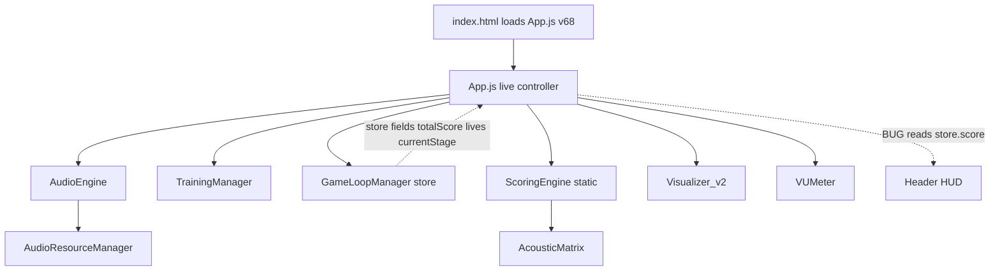
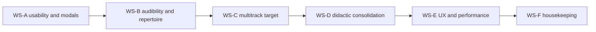

# Ear Training — Repair Plan (Specification for Code Mode)

Status: DRAFT — awaiting user approval
Author: Architect mode
Scope: Fix the 8 validated tester comments plus cross-cutting findings, **without regressing the current look and feel**.

---

## 1. Purpose and guiding principle

Deliver the validated improvements **incrementally and reversibly**, preserving everything that already works and looks good. Every workstream must be independently shippable and visually verifiable. No workstream may leave the app in a broken, silent, or "hung" state.

---

## 2. The do-not-break contract

These invariants must hold after **every** merged change:

1. The live entry point stays `./src/web/App.js?v=68` loaded from `index.html`. No re-pointing to legacy variants.
2. `index.html` continues to load `styles_v2.css` only. Any new CSS goes into `styles_v2.css` (never `styles.css`).
3. The onboarding flow (WELCOME to MODULE_SELECT to GAME_MODE_SELECT to DIFFICULTY_SELECT) still works end-to-end.
4. Audio always starts only after a user gesture; `AudioContext` is never created before interaction.
5. No `undefined`/`NaN` is ever rendered into the HUD, stats, or modals.
6. Every modal has a working escape action (continue, retry, restart, or return to menu) that also stops or hands off audio.
7. No new console errors; the existing global error overlay (see Section 3) is treated as a canary.
8. Multitrack stem loading, single-source OGG playback, and pink/white generators all still function.

---

## 3. Runtime snapshot — the actual truth

The documentation currently lies. The real wiring is:



Key facts:

- Live controller: `src/web/App.js` (not `App_v43.js` as `PROJECT_STATE.md` claims).
- Global error overlay injects red divs on any error/unhandledrejection/console.error — useful canary, risky for demos.
- Two progression systems coexist: `TrainingManager` (own `stage`, `lives`, `advanceStageOrLevel`) and `GameLoopManager.store` (`currentStage`, `lives`, `totalScore`, `evaluateTrialOutcome`). `TrainingManager.gameLoopStore` is **never assigned**.
- `AUDIO_SOURCES` contains duplicate entries for all 5 multitrack sessions, which shadows the `MULTITRACK_SESSIONS.targetStem` logic.

---

## 4. Workstream A — Usability, HUD and modal wiring (comments 4 and 5)

### A1. HUD correctness

- In `renderHUD()` (`src/web/App.js:1064`): replace `store.score` with `store.totalScore` for both the value and the rank thresholds.
- Rank thresholds (Pro >= 4000, Ingeniero >= 2000, else Tiracables) must read `store.totalScore`.
- Resolve the stage display conflict: `renderQuizInterface()` (`src/web/App.js:1109`) overwrites `#soundgymStage` with `trainer.stage` while `renderHUD` writes `store.currentStage`. Standardize on `store.currentStage` as the single source; boss label remains a presentation state.

### A2. Lives rendering

- `#livesContainer` exists (`index.html:90`) but nothing writes to it. Add `renderLives(store)` invoked from `renderHUD()`.
- Render up to `store.maxLives` (5) heart icons; filled = remaining lives, dimmed = lost.
- Add CSS classes `.lives-container` and `.life-icon` (and a lost state) to `styles_v2.css` consistent with the existing glass/dark theme.

### A3. Single source of truth for progression

- Assign `this.trainer.gameLoopStore = this.gameLoop.store` inside `App.init()` immediately after constructing `GameLoopManager`.
- Make `GameLoopManager.store` authoritative for `lives`, `currentStage`, `currentLevel`, `totalScore`.
- Convert `TrainingManager` into a **pure generator**: remove its own live/stage mutation (`advanceStageOrLevel`) or make it delegate to `GameLoopManager`. Keep `getRankTitle()` but source rank from the store.

### A4. Modal wiring (the hang + no-exit bug)

- Bind `#btnContinueLevelUp` (`index.html:567`) — currently unbound. Handler:
  1. Hide `#levelUpModal`.
  2. `this.gameLoop.nextTrial()`.
  3. `this.trainer.startNewTrial()` + `this.renderQuizInterface()`.
  4. `this.audio.setRoute('A')`; if audio paused, keep paused until user presses Play.
- Bind `#btnRetryBoss` (`index.html:585`) — currently unbound. Handler: hide `#bossDefeatModal`, force stage back to 4, `startNewTrial()`, `renderQuizInterface()`.
- Add a **campaign-complete / thank-you** end state (comment 5 request):
  - Show a modal: "Gracias por entrenar tu oído conmigo. Firmado: manu."
  - Single button "Volver al Menú" that calls `this.audio.stopAllAudio()`, resets session state, and `setAppState('WELCOME')` or `'MODULE_SELECT'`.
  - Trigger when the final level/stage is cleared (define the exact condition in Workstream B).
- Guarantee audio does not keep looping behind any terminal modal: call `stopAllAudio()` when entering Game Over / campaign-complete.

### A5. Game Over information

- `showGameOverModal()` (`src/web/App.js:1576`): add rank reached, level reached, and stage reached, reading from `gameLoop.store`.
- Add the three rows to `#gameOverModal` in `index.html` (mirroring the existing `detail-row` pattern).

Acceptance: lives, score, rank, and stage are always visible and numerically correct; both boss modals and Game Over are dismissible; the campaign-complete screen returns to the menu with silence.

---

## 5. Workstream B — Audibility and lesson repertoire (comments 2 and 6)

### B1. Audible difficulty curve

Problem: difficulty currently **inverts** audibility (`easy` x2.5, `hard` x1.2, min 1.5 dB), and base scenario gains are only +-2 to +-6 dB. This yields targets like "high shelf 7354 Hz +2.4 dB".

Specify a new, audibility-first generator in `TrainingManager`:

| Difficulty | Target abs gain range | Notes |
|---|---|---|
| easy | 9 to 12 dB | unmistakable, single concept |
| normal | 6 to 9 dB | clearly audible |
| hard / pro | 4 to 8 dB | still clearly audible, adds Q/type challenge |

- Remove the shrinking multiplier; hard difficulty should raise *precision demands* (frequency, Q, filter type), not lower gain.
- Constrain frequencies to musical bands per filter type (shelves within 60 to 12000 Hz; peaking within 40 to 14000 Hz). Avoid narrow boosts above ~12 kHz on drums.
- Keep jitter, but bound it so the floor never drops below the difficulty minimum.
- Keep no-gain types (notch, highpass, lowpass) as-is; they are audible by bandwidth.

### B2. Full lesson / instrument rotation

Problem: Arcade normal with the default `pink_noise` forces class `synthetic`, which has **no scenario**, so it falls back to `_generateRandomTarget('normal')` which always emits `type: peaking` (the "only bells" complaint). Campaign only covers kick, snare, bass, guitars, master.

- Add the missing scenario keys to `ACOUSTIC_EQ_SCENARIOS`: `synthetic`, `master`, and `strings`.
- Introduce an explicit **curriculum rotation** decoupled from the monitoring source, e.g. a list per difficulty covering: kick, snare, hi-hat, crash/cymbals, toms, bass, electric guitars, acoustic guitars, keys/organ, lead vocals, backing vocals, room/overheads, strings, woodwind, piano, drum bus, master bus.
- Each stage/lesson maps to exactly one acoustic class and one or more scenario entries.
- `generateEasyTrial`, `generateNormalTrial`, `generateHardTrial` consume the rotation instead of depending solely on the selected source.
- Expand `generateBossTrial` beyond the current 4 hardcoded 2-band cases toward the instrument repertoire.

### B3. Class precedence rule

Define deterministic precedence for `currentAcousticClass`:
1. Multitrack session selected: use the **randomized target stem's** class (Workstream C).
2. Single-source track selected: use that source's `acousticClass`.
3. Synthetic generator (pink/white): use the **rotation's current lesson class**, not a forced `synthetic`.

Acceptance: every generated target is clearly audible at its difficulty; Arcade normal rotates through the full instrument catalog instead of only bells.

---

## 6. Workstream C — Randomized multitrack target stem (comment 1)

Problem: `targetStem` is hardcoded to the first stem in each session (`beat1_kick`, `orch_main`, `rb_kick_in`, `rb_kick`), and `updateTrainerAcousticClass()` returns early on the `AUDIO_SOURCES` duplicate, so the session branch is dead code and the class resolves to `drumbus`/`room`.

### C1. Randomize per trial

- Add `pickTargetStem(session)` selecting a random stem (optionally weighting toward pedagogically strong stems and excluding pure room/overhead if desired — see open decisions).
- Store the choice on the trial, e.g. `trainer.currentTargetStemId`.
- Derive `currentAcousticClass` from the chosen stem's `acousticClass`.

### C2. Dynamic target flag in audio

- Replace the static `source.isTarget = (stem.id === mtSession.targetStem)` (`src/web/AudioEngine.js:657`) with a setter `setTargetStem(stemId)` that re-evaluates all stems' `isTarget` flags.

### C3. UI sync

- The 🎯 badge in `renderStemMixer()` (`src/web/App.js:853`) must reflect the current randomized target. Re-render on new trial, or update the badge class/position.

### C4. Remove duplication

- Eliminate the shadowing: either remove the 5 multitrack entries from `AUDIO_SOURCES` and merge `MULTITRACK_SESSIONS` into the source dropdown, or keep them but exclude them from the acoustic-class lookup. Decision recorded in Section 9.

Acceptance: across repeated trials on the same session, the target stem varies; the 🎯 badge and acoustic class always match the randomized stem.

---

## 7. Workstream D — Didactic content consolidation (comment 3)

Problem: three panels render simultaneously and two parallel dictionaries (`ACOUSTIC_MATRIX` in `AcousticMatrix.js` and `ContextMatrix` in `ScoringEngine.js`) cover the same instruments. Also, `getPedagogicalFeedback(audioContextStr, ...)` receives a **source id** (e.g. `v_kick`) rather than a class key (e.g. `kick`), so the acoustic-context panel frequently returns nothing.

### D1. One matrix, clear roles

- Make `AcousticMatrix.js` the single source of truth for per-instrument band context.
- Remove `ContextMatrix` from `ScoringEngine.js`; migrate any unique content into `AcousticMatrix.js`.
- Define non-overlapping panel roles:
  1. "Leccion rapida" — what the target filter does (scenario name + instrument band), concise, one line.
  2. "Efecto de tu filtro en la mezcla" — consequence of the user's filter, from the matrix by class + band + polarity.
  3. "IMPACTO DE TU INTENTO (PRO)" — outcome/bad-practice analysis, pro/hard only.
- Guarantee the three never contradict or repeat: use priority so at most one "primary" lesson shows, with the others as distinct categories, or merge into a single card with three labeled sections.

### D2. Fix the class lookup

- Pass the resolved `acousticClass` (via Workstream B3 precedence) into `getPedagogicalFeedback` instead of a raw source id.

### D3. Content volume

- Expand each instrument's matrix entries (more bands, clearer boost/cut text) using the schema in Section 8.

Acceptance: each panel shows distinct, non-redundant, class-correct guidance; no panel is silently empty for a known instrument.

---

## 8. Lesson content schema and authoring workflow

### 8.1 Schema

```js
/** @typedef {Object} LessonBand
 *  @property {string} instrument   // canonical class key, e.g. 'kick','vocals','strings'
 *  @property {string} bandName     // human label, e.g. 'Sub-weight'
 *  @property {number} minHz
 *  @property {number} maxHz
 *  @property {number} baseGainDb   // signed, used by the generator
 *  @property {string} type         // peaking | lowshelf | highshelf | highpass | lowpass | notch
 *  @property {number} qFactor
 *  @property {string} boostText    // consequence of boosting
 *  @property {string} cutText      // consequence of cutting
 *  @property {string} lessonTag    // curriculum grouping, e.g. 'fundamentals','tone','space'
 *  @property {'low'|'medium'|'high'} severity  // didactic weight
 */
```

### 8.2 Authoring workflow

- All lesson content lives in one data module so it can grow without touching game logic.
- Sources may be: (a) original content authored in-repo, (b) material you own/license and drop into `content/reference/` (PDF/DOCX are extractable), (c) synthesized from general mixing principles.
- Sound on Sound articles must **not** be reproduced verbatim (copyright). Topics may inspire original text.
- Validation script (optional, Code mode): assert every class referenced by the rotation exists in the matrix, and every entry has non-empty boost/cut text.

Acceptance: adding a new instrument lesson requires editing only the data module.

---

## 9. Workstream E — UX and performance (comments 7 and 8)

### E1. Non-interactive difficulty indicator

- The header `#btnModeEasy/Normal/Hard` (`index.html:68`) remain styled as buttons during play.
- In the PLAYING state, either replace them with a static chip (e.g. "Dificultad: Normal") or apply a `readonly` class (no hover/active affordance, `pointer-events: none`).
- Restore the interactive selector in menu states.
- Update `updateHeaderModeButtons()` (`src/web/App.js:328`) to also set the chip label and the readonly state.

### E2. Concurrent stem loading

- `loadAudioSource()` (`src/web/AudioEngine.js:419`) loads stems strictly sequentially; `rock_band_session` has 23 stems.
- Replace the sequential loop with a bounded-concurrency loader (4 to 6 in flight).
- Load the target stem first, then the remainder.
- Raise the cache ceiling or confirm it comfortably exceeds the largest session's stem count (23).
- Drive `#audioLoadingSpinner` from `onLoadStart`/`onLoadComplete`/`onLoadError`.

Acceptance: large sessions load noticeably faster; the spinner reflects real progress; switching sessions does not thrash the cache.

---

## 10. Workstream F — Housekeeping and rules reconciliation

### F1. Documentation

- Update `PROJECT_STATE.md` to name `App.js` as the live controller and refresh the module map.
- Replace the hardcoded audio path with a single constant (e.g. `AUDIO_BASE_PATH`) used by `AudioEngine` and `AudioResourceManager`.

### F2. Dead code

- Move (prefer) or delete legacy variants: `App_v40..v45`, `App_temp1..5`, `App_recon_temp`, `App.js.part0..10`, `App.js.extracted`, `App.js.reconstructed.js`, `App.js.restored`, `App.js.stitched*`, and the duplicate `styles.css` if unused.
- Fix or remove: `drawPhaseCurve()` early `return true` (`Visualizer_v2.js:1011`), `setSourceCalibration()` no-op (`AudioEngine.js:116`), duplicate `fftBuffer` init, and the FFT size mismatch (align to one size across engine and visualizer).
- Honor or remove the `scoringEngine` argument in the `GameLoopManager` constructor.

### F3. Rules reconciliation

- `project_rules.txt` §3 says `assets/audio/[filename]`; the code uses `Music Ear Training/Oggs/`. Decide: move assets, or amend the rule to reality plus a shared path constant.
- §4 says real OGGs render flat; `Visualizer_v2.drawSpectrum()` applies 4.5 dB/oct + 40 dB offset. Decide: implement flat rendering, or amend the rule if the tilt is an intentional aesthetic (see open decisions).

Acceptance: docs match reality; no duplicate/legacy modules remain in the active tree; rules and code agree.

---

## 11. Sequencing and risk



| Order | Workstream | Risk | Why this order |
|---|---|---|---|
| 1 | A — Usability/modals | Low | Highest user pain; unblocks seeing score/lives; pure wiring |
| 2 | B — Audibility/repertoire | Medium | Core learning value; large but data-driven |
| 3 | C — Multitrack target | Medium | Depends on B3 precedence and content keys |
| 4 | D — Didactic consolidation | Medium | Depends on B/C class resolution |
| 5 | E — UX/perf | Low-Medium | Isolated; safe late |
| 6 | F — Housekeeping | Low | Do last, after behavior stabilizes |

Rule: each workstream lands as its own change set with its own verification pass; never mix F (cleanup) with behavior work.

---

## 12. Test matrix

| Scenario | Steps | Expected |
|---|---|---|
| HUD | Play arcade, answer trials | Score, rank, lives, stage update correctly |
| Lives loss | Answer wrong until zero | Game Over shows rank/level/stage; restart works |
| Boss win | Clear a boss | Level-up modal appears; Continue starts next trial; no hanging audio |
| Boss loss | Fail a boss | Defeat modal; Retry returns to stage 4 |
| Campaign end | Clear final level | Thank-you screen; Return to Menu; audio silent |
| Audibility | Generate per difficulty | Gains within specified ranges; clearly audible |
| Repertoire | Arcade normal repeated | Rotates instruments/types, not only bells |
| Multitrack | Repeat same session trials | Target stem varies; badge and class match |
| Didactic | Answer instrument trials | Three panels distinct, correct, non-empty |
| Difficulty chip | Enter PLAYING | No button affordance; label shown |
| Loading | Open rock band session | Loads faster; spinner reflects progress |
| Regression | Full onboarding to play | Flow intact; no console errors |

---

## 13. Open decisions (need user input)

1. Multitrack semantics: should the randomized target stem be soloed/emphasized, or is the EQ applied to the full mix with the stem flagged only pedagogically?
2. Didactic panels: merge the three into one multi-section card, or keep three cards with strictly distinct roles?
3. Audio path: move OGGs into `assets/audio/`, or amend `project_rules.txt` and adopt a shared path constant?
4. RTA rendering: implement the "flat for real OGGs" rule, or keep the current tilt as intentional and amend the rule?
5. Content source: have me synthesize lesson content now, or wait for PDFs/books you place in `content/reference/`?
6. Campaign completion: exact condition for the thank-you screen — after the final boss, or after clearing every lesson in the rotation?
